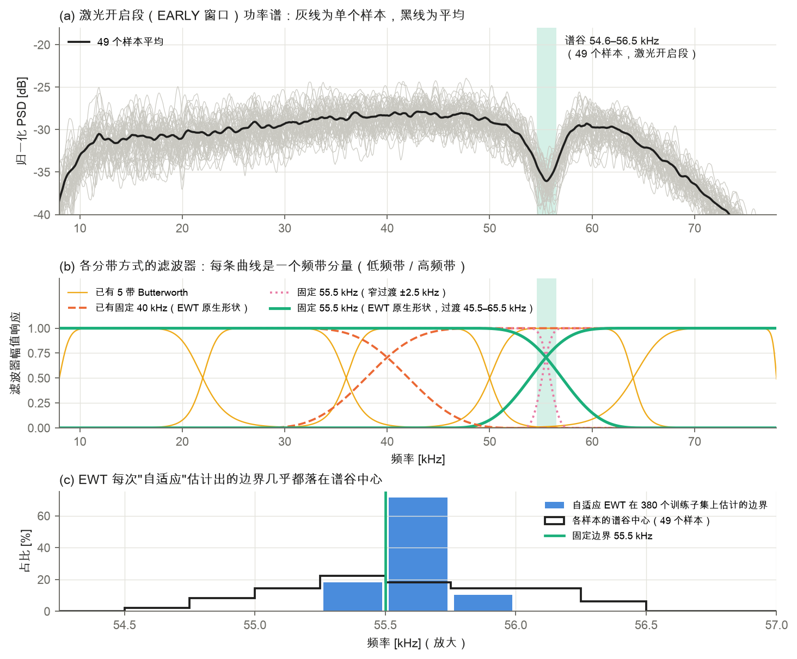

# ME5106 Mini Project 3 · 任务一：分带方法对照

**固定 55.5 kHz 分带 vs 已有固定频带 vs 自适应 EWT** —— 用声学信号预测 LPBF 激光功率与扫描速度时，EWT 方案的效果来自"选对频带"还是"自适应调整"？

**结论：来自选对频带，不需要自适应。**

- EWT 在 380 个训练子集中有 379 个估计出同一个约 55.5 kHz 的边界；把边界固定在 55.5 kHz，结果与 EWT 统计等效（4 项平均宏 MAPE 15.97% 对 15.88%）。
- 谷附近分带明显优于已有的 40 kHz 两带（EARLY 功率 −5.5 个百分点，p = 0.002）和 5 带 Butterworth（−11 个百分点）。
- 55.5 kHz 是测量链（传感器或传播路径）的固有谱谷：49 个样本都有（55.56 ± 0.45 kHz），与功率、速度无关，激光关闭后仍在原位，空闲噪声中没有。

| 方法 | EARLY 功率 | EARLY 速度 | LATE 功率 | LATE 速度 | 4 项平均 |
|---|---|---|---|---|---|
| 训练中位数基线 | 23.37 | 14.09 | 23.37 | 14.09 | 18.73 |
| 不分带 | 23.12 | 14.92 | 25.38 | 12.17 | 18.90 |
| 已有 5 带 Butterworth | 27.28 | 12.18 | 25.05 | 13.12 | 19.41 |
| 已有固定 40 kHz | 21.79 | 14.12 | 27.03 | 14.18 | 19.28 |
| **固定 55.5 kHz** | **16.29** | **11.56** | 24.56 | **11.46** | 15.97 |
| 自适应 EWT | 16.45 | 11.62 | **23.90** | 11.55 | **15.88** |

## 目录

| 路径 | 内容 |
|---|---|
| [`任务一_分带方法对照报告.pdf`](任务一_分带方法对照报告.pdf) | 正式报告（10 页） |
| [`完整报告.md`](完整报告.md) | 同内容 Markdown 版 |
| [`交付说明.md`](交付说明.md) | 一页纸摘要 |
| [`图/`](图) | 8 张图 |
| [`数据/`](数据) | 全部结果数据，含逐折原始预测；见 [`数据说明.md`](数据/数据说明.md) |
| [`代码/`](代码) | 生成结果的脚本 |

## 复现说明

脚本建立在小组共享的主流程（EWT → 9 类特征 → SFS → SVR）之上，需放在该流程的 `project3/analysis/fixed55_control/` 下运行，依赖 numpy 2.5.4、scipy 1.18.1、scikit-learn 1.9.1、pandas 2.2.3、h5py、matplotlib、reportlab。课程原始数据与小组主流程代码不包含在本仓库中。

## 局限

属于对已分析数据的事后敏感性分析；边界位置的误差曲线不平滑，55.5 kHz 是有物理依据的选择而非调出的最优值；所有方法按组平均仍不如中位数基线（根源在固定 2–10 ms 窗口丢失扫描时长信息）。详见报告第 4 节。
