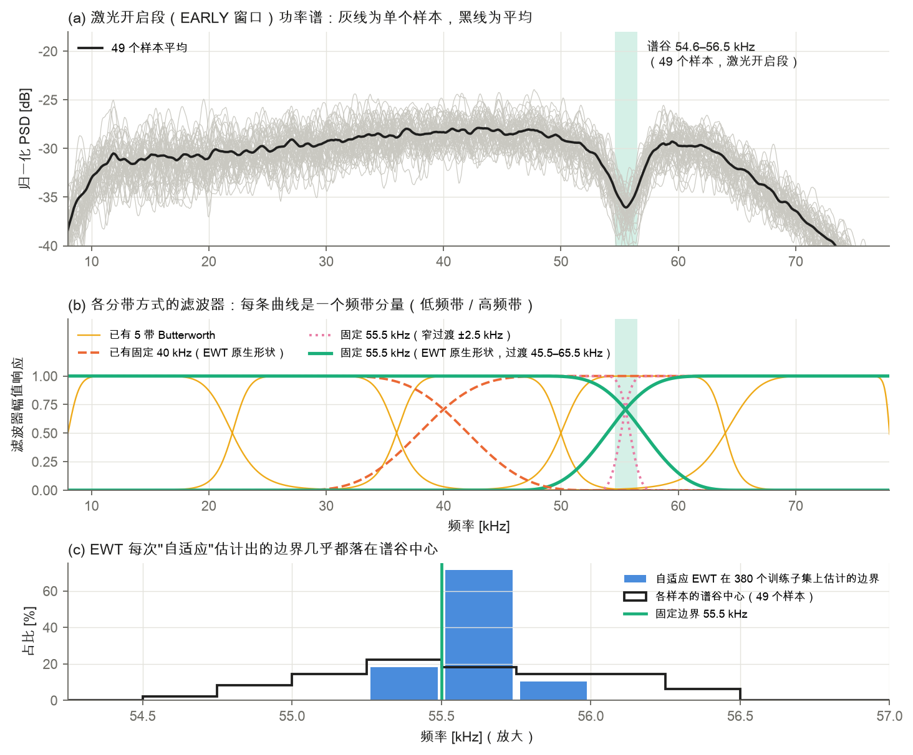
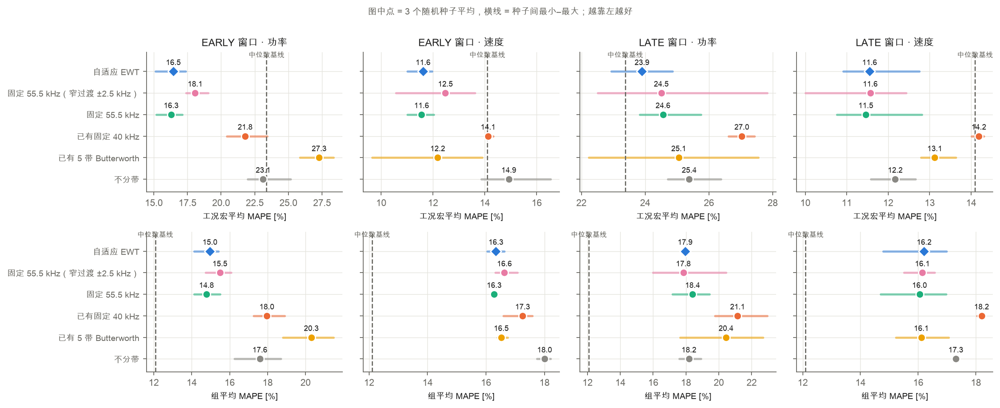
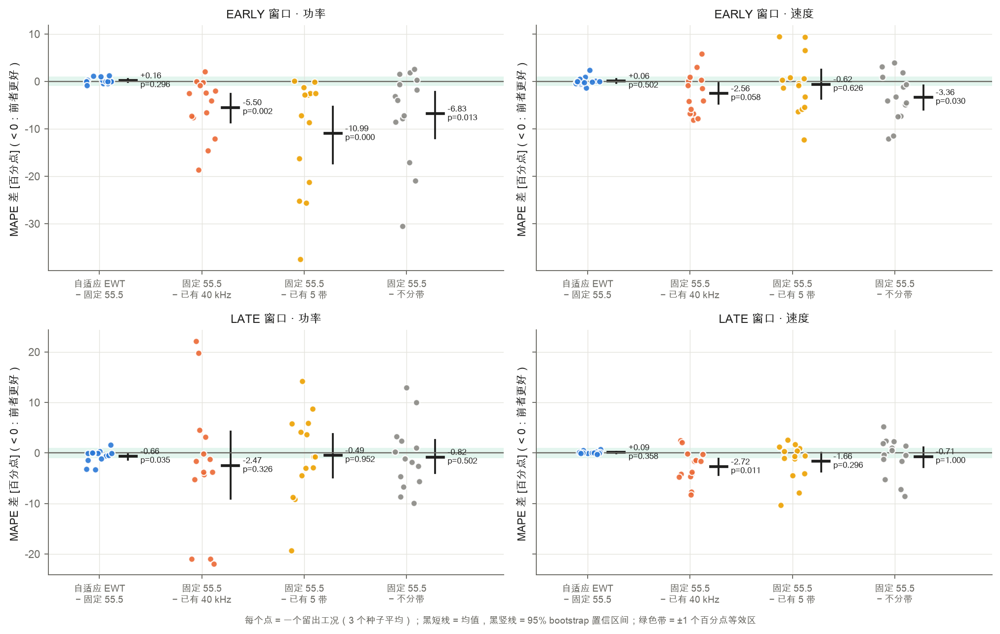
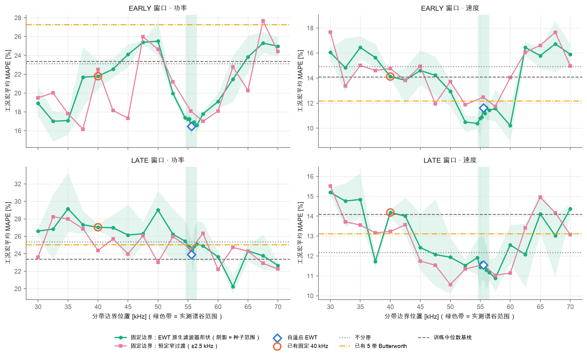
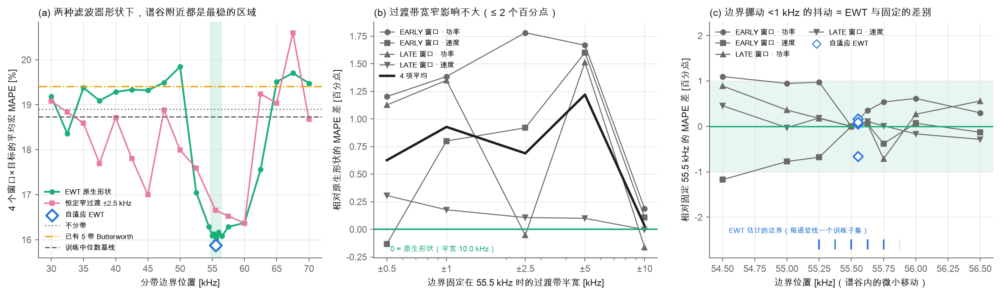
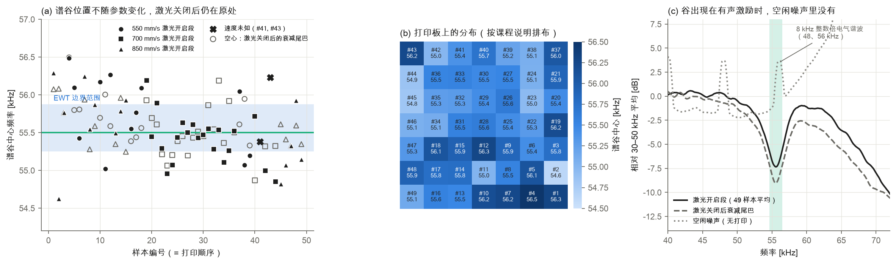
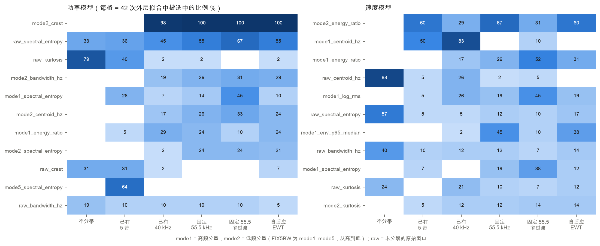
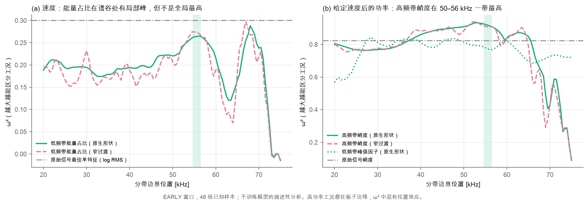

# 任务一：分带方法对照——固定 55.5 kHz、已有固定频带与自适应 EWT

> **问题**：EWT 方案的效果，来自"选对了频带"，还是来自"自适应调整"？
>
> **结论**：来自**选对频带**。EWT 的"自适应"在本数据上退化成一个常数：380 个训练子集里，有 379 个估计出的都是同一个约 55.5 kHz 的边界。把边界直接固定在 55.5 kHz，EARLY 窗口下的结果与 EWT 统计上等效（差值的 90% 置信区间落在 ±1 个百分点以内）。这个边界对应的是一个**测量链固有的谱谷**：它在 49 个样本中都存在，激光关闭后仍在原位，不随功率、速度变化。因此不需要每折重新估计，用一次性确定的固定滤波器就够了。
> 选在谷附近的边界明显优于已有的 40 kHz 等宽两带和已有的 5 带 Butterworth。不过边界位置的误差曲线很不平滑，55.5 kHz 应理解为"有物理依据的合理选择"，而不是调出来的最优值。

---

## 1. 做了什么

在同学已冻结的流程上，只改变"怎么分带"，其他一律不变：

| 保持不变 | 内容 |
|---|---|
| 信号 | 8 kHz 四阶零相位高通；EARLY 窗口（起点后 2–10 ms）与 LATE 窗口（6–14 ms），各 1280 点 |
| 特征 | 原始窗口和每个分量各 9 类：log RMS、能量占比、峭度、峰值因子、包络变异系数、包络 p95/中位数、谱质心、谱带宽、谱熵；同组 5 条轨迹取中位数 |
| 模型 | 贪心 SFS（功率最多 5 个特征、速度最多 3 个，内层按工况划分）＋ SVR（功率 C=100、γ=0.05；速度 C=50、γ=0.1；ε=0.1） |
| 验证 | 14 个工况逐一留出 × 3 个随机种子 × 2 个窗口 = 84 个外层折，直接复用 `ewt_verification/results/bundles` 中冻结的划分 |

比较的分带方式共 48 种：

| 代号 | 含义 | 用途 |
|---|---|---|
| `EWT` | 自适应 EWT_STABLE，每个训练子集重新估计边界（复用缓存视图） | 被检验对象 |
| `NAT_55.5` | **固定 55.5 kHz**，滤波器形状与 EWT 完全相同（过渡带 45.5–65.5 kHz） | **主对照**：只去掉"自适应" |
| `NAT_40` | 固定 40 kHz 等宽两带（= 包里已有的 FIXEDK 对照） | 已有固定频带 ① |
| `FIX5BW` | 包里已有的 5 条等宽 Butterworth 带（8–22–36–50–64–78 kHz），这次放进同一套 9 类特征 | 已有固定频带 ② |
| `RAW` | 不分带 | 分带本身有没有用 |
| `NAT_30…70` | 边界扫描 30–70 kHz，每 2.5 kHz 一个点，EWT 原生形状 | 位置效应 |
| `MEY2.5_30…70` | 同样的扫描，但过渡带固定为 ±2.5 kHz | 把位置和过渡带宽度分开（原生形状的过渡宽度会随位置变化） |
| `MEY{0.5,1,2.5,5,10}_55.5` | 边界固定 55.5 kHz，改变过渡带半宽 | 滤波器形状效应 |
| `NAT_54.5…56.5` | 谷内微移（54.5、55、55.25、55.5、55.625、55.75、56、56.5 kHz） | 边界抖动带来的"噪声" |

几项校验：

- 宽度取 d = γ·b 时，Meyer 滤波器与 EWT 原生滤波器的差异在 1e-14 量级，说明原生形状正好是这套参数化的一个特例。
- 两带分解保留了 100% 能量。
- 复刻的 5 带 Butterworth 与包里缓存的分量差异在 1e-15 量级。
- 本机重跑的 EWT 与 Linux 存档相差不超过 0.12 个百分点。

**统计方法**：在 14 个工况上做配对比较（每个工况先对 3 个种子取平均），报告均值差、95% bootstrap 置信区间（10000 次重采样）和 Wilcoxon 符号秩检验。等效性检验（TOST）的界限在跑实验前就定为 ±1 个百分点：90% 置信区间完全落在 ±1 以内，才判为"等效"。

---

## 2. 结果

### 2.1 EWT 的"自适应"实际上是常数（图 1）



- 380 个训练子集（外层 + 内层，两个窗口）中，有 379 个只估计出**一个**边界，范围是 55.25–55.875 kHz；唯一的例外是一个 EARLY 子集，多出了一个 19.875 kHz 的边界。
- 这个边界正好落在功率谱的谷里（图 1a、1c）。
- EWT 原生滤波器的过渡带很宽：边界 55.5 kHz 时，过渡带横跨 **45.5–65.5 kHz**（图 1b）。边界在 55.25 和 55.875 kHz 之间移动，对滤波器的影响微乎其微。

### 2.2 主对照（图 3、图 6）



工况宏平均 MAPE（%，3 个种子的平均；括号内为种子间范围）：

| 方法 | EARLY 功率 | EARLY 速度 | LATE 功率 | LATE 速度 | 4 项平均 |
|---|---|---|---|---|---|
| 训练中位数基线 | 23.37 | 14.09 | 23.37 | 14.09 | 18.73 |
| 不分带 RAW | 23.12 | 14.92 | 25.38 | 12.17 | 18.90 |
| 已有 5 带 Butterworth | 27.28 | 12.18 | 25.05 | 13.12 | 19.41 |
| 已有固定 40 kHz | 21.79 | 14.12 | 27.03 | 14.18 | 19.28 |
| **固定 55.5 kHz** | **16.29** | **11.56** | 24.56 | **11.46** | 15.97 |
| 固定 55.5 kHz（窄过渡 ±2.5） | 18.07 | 12.48 | 24.51 | 11.57 | 16.66 |
| 自适应 EWT | 16.45 | 11.62 | **23.90** | 11.55 | **15.88** |

- 物理单位的宏平均误差（EARLY）：固定 55.5 kHz 为功率 43.1 W、速度 81.6 mm/s；EWT 为 43.5 W、82.2 mm/s。
- 3 个种子先平均预测再算误差（即最终提交用的口径）：固定 55.5 kHz 为 16.25 / 10.20（EARLY 功率 / 速度），EWT 为 16.13 / 9.95。
- **按 4 项平均，不分带、已有 5 带、已有 40 kHz 三种方式都不如直接猜中位数**（18.9–19.4% 对 18.73%）；只有边界放在谷附近的方法明显更好。



配对比较（14 个工况，单位：百分点，负值表示前者更好）：

| 比较 | 窗口·目标 | 均值差 | 95% 置信区间 | Wilcoxon p | ±1 等效 |
|---|---|---|---|---|---|
| **EWT − 固定 55.5** | EARLY 功率 | +0.16 | [−0.13, 0.48] | 0.30 | **是** |
| | EARLY 速度 | +0.06 | [−0.34, 0.51] | 0.50 | **是** |
| | LATE 功率 | −0.66 | [−1.36, −0.03] | 0.035 | 否 |
| | LATE 速度 | +0.09 | [−0.03, 0.23] | 0.36 | **是** |
| **固定 55.5 − 已有 40 kHz** | EARLY 功率 | −5.50 | [−8.64, −2.66] | 0.002 | — |
| | EARLY 速度 | −2.56 | [−4.69, −0.29] | 0.058 | — |
| | LATE 功率 | −2.47 | [−9.04, 4.23] | 0.33 | — |
| | LATE 速度 | −2.72 | [−4.34, −1.11] | 0.011 | — |
| **固定 55.5 − 已有 5 带** | EARLY 功率 | −10.99 | [−17.32, −5.38] | <0.001 | — |
| | 其余 3 项 | −0.49 至 −1.66 | 均包含 0 | ≥0.30 | — |
| **固定 55.5 − 不分带** | EARLY 功率 | −6.84 | [−12.04, −2.26] | 0.013 | — |
| | EARLY 速度 | −3.37 | [−5.98, −0.88] | 0.030 | — |
| | LATE 两项 | −0.82 / −0.71 | 均包含 0 | ≥0.50 | — |

**唯一偏向自适应的结果是 LATE 功率（EWT 好 0.66 个百分点）。**但这个差别不应解读为"自适应有用"，理由有三：

1. 它比同一模型换随机种子造成的波动小得多（LATE 功率的种子范围中位数是 4.05 个百分点）；
2. 它落在边界在谷内挪动不到 1 kHz 造成的抖动范围之内（LATE 功率为 1.61 个百分点，见 2.4 节）；
3. LATE 功率这一项上，所有方法（23.9–27.3%）都不如中位数基线（23.37%）。在一个连基线都没超过的设定里，0.66 个百分点没有实际意义。

### 2.3 边界位置（图 4、图 5a）



- **谱谷附近是最稳的区域。**原生形状下，4 项平均误差最低的 5 个边界全部在谷内：55.75、55.5、56.5、55、55.625 kHz（15.8–16.1%）。最差的是 50、65、67.5 kHz（19.5–19.9%）。
- 把过渡带固定为 ±2.5 kHz 后，最好的三个边界是 60、57.5、55.5 kHz（16.4–16.7%），仍然在谷附近或略高一点；40 kHz 是 18.7%。所以，"谷附近更好"不是 EWT 宽过渡带造成的假象。
- 在 4 个窗口×目标中，固定 55.5 kHz 在 17 个扫描位置里分别排第 1（EARLY 功率）、第 3、第 6（LATE 功率）和第 2。

**曲线很不平滑**：相邻 2.5 kHz 的两个边界，结果可以差 5–6 个百分点（例如窄过渡下 EARLY 功率：37.5 kHz 为 16.2%，40 kHz 为 22.5%）。在某个单项上，也有别的位置比 55.5 kHz 好，例如 LATE 功率在 62.5 kHz 为 20.3%。这反映的是 46 组样本上 SFS+SVR 的高方差。**所以 55.5 kHz 的依据是物理上的谱谷（不用标签就能确定），而不是在这张图上挑最低点**；按测试结果挑边界属于过拟合。



### 2.4 过渡带宽度与边界抖动（图 5b、5c）

- **宽度**：边界固定 55.5 kHz，过渡带半宽从 ±0.5 改到 ±10 kHz，4 项平均变化不超过 1.2 个百分点，单项不超过 1.8 个百分点。原生的宽过渡（±10 kHz）不比窄过渡差。所以固定版本直接沿用 EWT 的滤波器形状即可。
- **噪声参照**：

| | EARLY 功率 | EARLY 速度 | LATE 功率 | LATE 速度 |
|---|---|---|---|---|
| 同一模型换种子的范围（中位数） | 2.05 | 1.75 | 4.05 | 2.05 |
| 边界在 54.5–56.5 kHz 内移动的标准差 | 0.38 | 0.46 | 0.47 | 0.22 |
| 边界在 54.5–56.5 kHz 内移动的范围 | 1.10 | 1.24 | 1.61 | 0.74 |
| \|EWT − 固定 55.5\| | 0.16 | 0.06 | 0.66 | 0.09 |

EWT 与固定 55.5 kHz 的差别，都落在"边界在谷内挪一点点"造成的抖动范围之内。具体来说：EARLY 窗口里，86% 的外层折中 EWT 的边界恰好就是 55.5 kHz，约 45% 的预测与固定版本完全相同；其余差别来自内层子集上的边界略有变化（如 55.25、55.75 kHz），改变了 SFS 选第 2、3 个特征的路径。LATE 窗口的外层边界多为 55.625 kHz（偶尔为 55.25 kHz），所以预测从不完全相同。**自适应带来的不是更好的频带，而是特征选择路径的随机翻转。**

### 2.5 谱谷的物理来源（图 2）



`valley.py` 直接读取原始 MAT 文件，用包里的轨迹时间，对全部 49 个样本（含 3 个未知样本）分析，不使用任何标签。提取出的窗口与流程缓存完全一致（差异为 9e-16）。

| | 谷中心 [kHz] | 谷深 [dB] |
|---|---|---|
| 激光开启段（EARLY 窗口） | 55.56 ± 0.45（54.6–56.5） | 中位数 7.2（最小 4.6） |
| 激光关闭后的衰减尾巴 | 55.58 ± 0.34（54.9–56.5） | 中位数 7.7（最小 5.4） |
| 同一样本：尾巴 − 开启段 | +0.02 ± 0.45 | — |
| 空闲噪声 | 55.5 kHz 附近没有谷（50–60 kHz 内单调上升） | — |

- **与工艺参数无关**：谷中心与功率的相关 ρ = 0.04（p = 0.79），与速度的相关 ρ = −0.11（p = 0.45；三个速度组之间的 Kruskal 检验 p = 0.12）。
- **激光关闭后仍在原位**：尾巴里已经没有熔池在发声，只剩声音在腔体和传感器里的余振，谷却还在同一频率。说明它不是熔池声源的特征，而是传播路径或传感器的传递函数（例如反共振，或光程差约 3 mm 的两路干涉，后者对应 c/2Δ ≈ 55.5 kHz）。
- **只在有声激励时出现**：空闲噪声里没有这个谷，说明它不是电子噪声，而是声学通道本身的响应。空闲谱里 48、56 kHz 的尖峰是 8 kHz 整数倍的电气谐波，与谷无关。
- **存在缓慢漂移**：谷中心与打印顺序弱相关（ρ = −0.44，p = 0.002），总漂移约 1–2 kHz，可能来自传感器温度变化。但这比原生滤波器 ±10 kHz 的过渡带窄一个数量级，对分带没有实际影响。另外，EWT 只按训练集的平均谱估计边界，本来也跟踪不了单个样本的漂移。
- 3 个未知样本的谷分别在 55.38 kHz（#41）、56.23 kHz（#43）、55.15 kHz（#49），所以固定滤波器对它们同样适用。

> 物理上的结论：55.5 kHz 是**测量系统的固有频率特征**，不是熔池物理的一部分，也不随工艺参数改变。对固定的测量系统来说，它是常数，用固定边界最合适；只有更换传感器或调整安装位置时，才需要重新标定一次。

### 2.6 为什么谷附近分带更好：机理（图 7、图 8）



- **功率**：边界在 40 kHz 和在谷附近时，功率模型的第一个特征几乎都是低频带峰值因子 `mode2_crest`（42 次拟合中被选 41–42 次）。两者的差别在后面入选的特征上：谷附近分带会补上低频带带宽 / 质心和低频带谱熵，40 kHz 分带则偏向高频带质心和能量占比。
- **速度**：谷附近分带时，速度模型主要依赖低频带能量占比 `mode2_energy_ratio`（67% 被选中）和高频带包络 p95/中位数；40 kHz 和不分带时，则退回到谱质心（83% 和 88%）。
- **5 带 Butterworth** 的第 4 条带是 50–64 kHz，正好把谷切在带的中间，功率模型只能依赖第 5 带的谱熵和原始峭度，结果 EARLY 功率误差高达 27%。



不训练模型、只看单个特征区分工况能力（ω²）的描述性分析：

- 给定速度后的功率：高频带峭度在边界约 50–56 kHz 时 ω² 最高（53 kHz 处 0.933，55.5 kHz 处 0.918，40 kHz 处 0.859，原始信号峭度 0.82）。把冲击性成分隔离到谷以上的频带后，它对功率的区分度更高。
- 速度：低频带能量占比在 55.5 kHz 处有一个**局部峰**（0.264，40 kHz 处为 0.194），但这**不是全局最高**：68 kHz 处为 0.288，原始 log RMS 为 0.30。所以这部分证据只能说明谷是一个有效的分界点，不能说明它是唯一最优。
- 注意：功率最高的几个工况都在板子边缘，而且每个工况只有一组，ω² 中混有位置效应。

### 2.7 对未知样本的影响

在最终协议下（46 组全部训练，内层用 KFold(5) 按工况划分，3 个种子取平均），同一台机器上的结果：

| 样本 | 目标 | 自适应 EWT | **固定 55.5 kHz** | 窄过渡 55.5 | 已有 40 kHz | 已有 5 带 |
|---|---|---|---|---|---|---|
| #41 | 功率 [W] | 375.5 | **375.5** | 343.6 | 277.8 | 275.8 |
| | 速度 [mm/s] | 756 | **763** | 684 | 699 | 693 |
| #43 | 功率 [W] | 365.0 | **365.0** | 332.8 | 260.5 | 296.7 |
| | 速度 [mm/s] | 779 | **804** | 744 | 746 | 689 |
| #49 | 功率 [W] | 205.8 | **205.8** | 210.2 | 202.9 | 227.9 |
| | 速度（已知 850） | 754 | **751** | 861 | 781 | 777 |

- 全部 46 组的参考边界恰好是 55.5 kHz，所以固定版本给出的**功率预测与 EWT 完全一致**；速度相差不超过 25 mm/s，原因是内层特征选择路径不同。本机 EWT 与 Linux 存档一致（例如 #41 功率都是 375.5 W）。
- **最终答案对分带方式很敏感**：换成 40 kHz 或 5 带，#41 和 #43 的功率预测会低约 70–105 W。这再次说明分带位置要按物理依据事先确定，不能看结果再挑。
- #49 速度（已知 850 mm/s）只有一个样本，不能用来挑方法。

---

## 3. 结论与建议

1. **回答任务问题：效果来自选对频带，不需要自适应。**EWT 在本数据上每次都估计出同一个边界；固定 55.5 kHz 在 EARLY 窗口和 LATE 速度上与 EWT 统计等效，4 项平均误差为 15.97% 对 15.88%，差别在噪声范围以内。
2. **频带选在哪里很关键。**谷附近的分带比已有 40 kHz 两带（EARLY 功率好 5.5 个百分点）和已有 5 带 Butterworth（好 11.0 个百分点）明显更好。而后两者加上不分带，4 项平均都不如直接猜中位数。
3. **55.5 kHz 有物理依据**：这是测量链（传播路径或传感器）的固有谱谷，与工艺参数无关，激光关闭后依然存在。
4. **报告中建议的写法**：改用"固定 55.5 kHz 两带分解（Meyer / EWT 型滤波器）"，并说明"边界取自训练谱上稳定的谱谷，该谷经验证为测量系统特征"。EWT 可以作为一次性确定边界的工具来介绍，不必在每个折里重新估计。这样做更简单、确定、可复现，也更容易解释。
5. 过渡带的宽窄影响不大（不超过约 2 个百分点），沿用 EWT 原生形状即可。

## 4. 局限（需如实写进报告）

- **不是独立验证**：这些数据已被多轮分析用过，v2 的扫描是在看过 v1（40/50/55.5/60 kHz）的结果之后才设计的，属于事后敏感性分析。
- **55.5 kHz 不是盲选**：它由 EWT 在全部 46 组训练谱上（不用标签）确定，用到了测试折的频谱，属于"设计好的固定滤波器"。不过谷在每个样本上都存在，换任何训练子集都会得到几乎相同的值（379/380）。
- **边界位置的结果噪声很大**：2.5 kHz 的移动就可能让误差变化 5–6 个百分点，单项上存在比 55.5 kHz 更好的位置。这些不能作为选边界的依据。
- **所有方法按组平均都仍不如中位数基线**（固定 55.5 kHz 为 14.8% / 16.3%，基线为 12.1% / 12.1%）。分带方式解决不了这个问题。根本原因在于固定截取 2–10 ms 窗口，丢掉了扫描时长（t = L/v）这一速度信息，另外还存在板上位置对信号幅值的影响。例如 #43 的速度，所有分带方式都预测在 690–805 mm/s，而它的激光开启时长（约 20 ms）对应 550 mm/s。
- LATE 窗口（6–14 ms）对 850 mm/s 的轨迹（激光开启约 12–15 ms）可能已经进入激光关闭后的衰减段，LATE 的结果解读要谨慎。
- 对谱谷物理成因的判断（反共振或两路干涉）没有传感器规格和安装几何来佐证，只能确定它属于测量链，而不是熔池。

## 5. 复现

依赖与 `requirements-main.txt` 相同（numpy 2.5.4、scipy 1.18.1、scikit-learn 1.9.1 等）。在本目录下运行：

```bash
python compare.py --workers 8     # 48 种分带 × 84 个外层折，约 4 分钟；结果缓存在 results/cache/，再次运行只补缺失部分
python valley.py                  # 谱谷物理分析，读取原始 MAT，约 1 分钟
python separability.py            # 不训练模型的 ω² 扫描，约 1 分钟
python finalize_unknown.py        # 未知样本，按最终协议
python figures.py                 # 生成 8 张图到 figures/
```

| 文件 | 内容 |
|---|---|
| `protocol.json` | v2 实验协议（含事先规定的等效界限与禁止事项） |
| `bands.py` | 全部分带方式的定义（原生 EWT、恒定宽度 Meyer、5 带 Butterworth 复刻） |
| `results/mean_metrics.csv` | 每个模型的宏平均 / 组平均 MAPE、MAE 和种子范围 |
| `results/ensemble_metrics.csv` | 3 个种子先平均预测再算误差的口径 |
| `results/paired_comparisons.csv` | 配对比较、置信区间、Wilcoxon 检验和等效性判断 |
| `results/noise_reference.csv` | 种子范围和谷内微移造成的抖动 |
| `results/selection_frequency.csv` | 各模型的特征选择频率 |
| `results/valley_by_sample.csv`、`valley_summary.json` | 每个样本的谷中心和谷深，以及相关性统计 |
| `results/separability.csv` | ω² 扫描结果 |
| `results/unknown_summary.csv` | 未知样本在各种分带下的预测 |
| `results/archived_reference.csv` | 包里原有的 Linux 存档结果，供对照 |

注意：`ewt_complete` 等冻结目录只读不写；本目录的脚本不能命名为 `run.py`，否则会与同学代码中的 `import run as old` 冲突。
